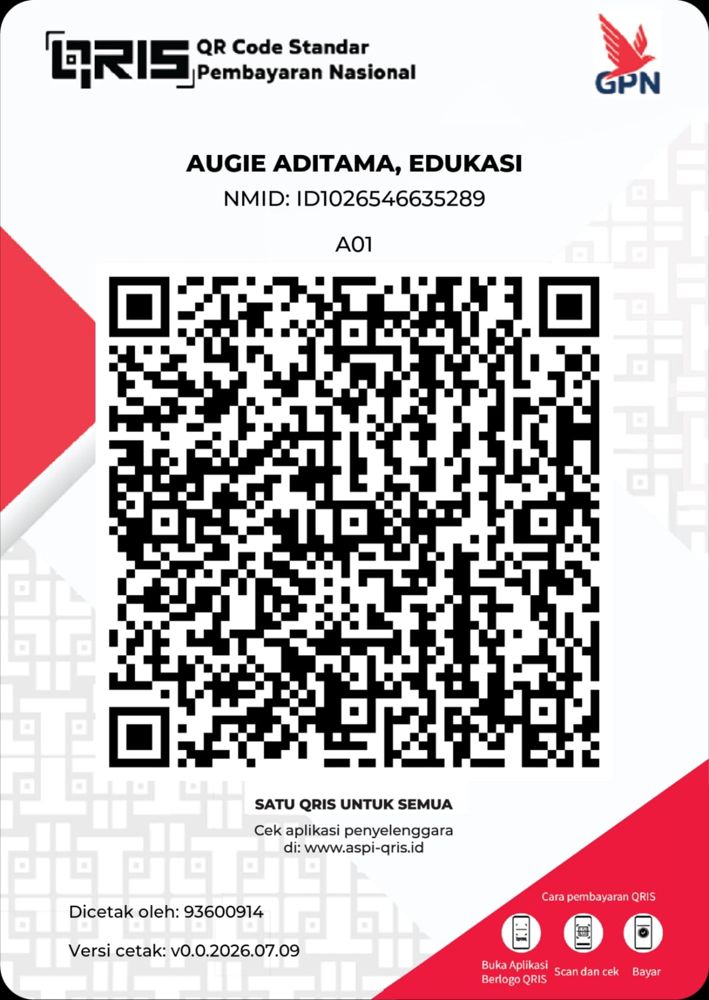

---

[+lie...;Always+Learning%2C+Always+Growing)](https://git.io/typing-svg)

---

## Support

[Support me on Saweria](https://saweria.co/augieaditama)

Support via QRIS (Indonesia)

 

**Recipient: AUGIE ADITAMA, EDUKASI** 
NMID: `ID1026546635289`

Scan with your bank or e-wallet app, or tap the image for full size. Check that the recipient name and amount are correct in your payment app before confirming. Never share your PIN or OTP.

## About

I study statistics and build projects in applied machine learning, with a focus on computer vision and predictive modeling. My work includes image-classification and segmentation pipelines, inference APIs, and developer tools for working with language models.

I use Python for data analysis and modeling, TypeScript for web interfaces, and Rust for command-line tooling. I care about how a model is evaluated, whether a project can be reproduced, and where its results stop being reliable.

I am open to part-time remote opportunities in data analysis, Python automation, and applied ML.

 

## TECH STACK

**Languages & Core**

**ML / DL Frameworks**

**Data & Visualization**

---

## MISSION LOG: Featured Projects

<table>
<tr>
<td width="50%">

### [E-WISE](https://github.com/tamaraw01/ewise-triage)
> CLIP-based e-waste image-triage prototype with centroid inference, margin rejection, and a Next.js interface. Reference metrics are not field-performance estimates.

</td>
<td width="50%">

### [ctx-budget](https://github.com/tamaraw01/ctx-budget)
> Local Rust CLI for estimating codebase token usage, ranking files, and exporting text, JSON, or CSV reports. Estimates use a word/byte heuristic, not a model tokenizer.

</td>
</tr>
<tr>
<td width="50%">

### [NanoCoT](https://github.com/tamaraw01/nanocot)
> Experimental FastAPI chat proxy with heuristic request routing and tagged-response cleanup. Streaming is buffered; model-quality gains and API savings are not established.

</td>
<td width="50%">

### [Glaucoma research](https://github.com/tamaraw01/Glaucoma-Detection-from-Deep-Fundus-Images)
> EfficientNet-B3 research pipeline with patient-grouped splits, evaluation, and Grad-CAM. Setup limitations are documented; no clinical performance is established.

</td>
</tr>
</table>

---

## CONNECT

---

